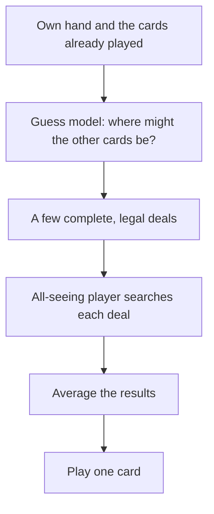
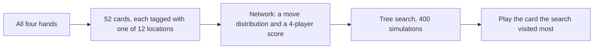
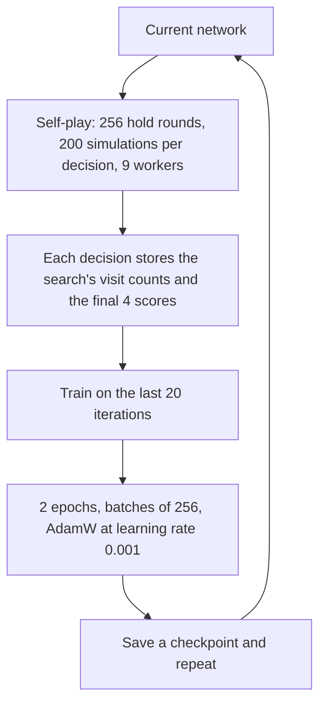

# Hearts-NN

A neural-network Hearts player you can play against in the browser.

The long-term player is two pieces. An **all-seeing player** is trained first, on deals where every hand is visible, so search is an ordinary perfect-information problem. A **guess model** (not trained yet) will later say where the unseen cards might be. At the table the bot will sample a few legal deals, ask the all-seeing player how each one turns out, and play the card that looks best on average.

What you can play today is the all-seeing player. In the UI it is the **Omniscient** opponent. It really does see every card.

## How a hand works

Four people, one deck, 13 cards each. A match is a run of rounds. Points from each round add up, the match ends when someone reaches **100**, and the lowest total wins.

Each round is **13 tricks**. Whoever has the 2 of clubs leads the first. After that, the winner of a trick leads the next. The leader plays a card and the other three play in order. If you still have the suit that was led, you play that suit. If you are out of it, you can play any card. The highest card of the led suit takes the trick, and those four cards stay with the winner. That pile is what gets scored.

| Card | Points |
| --- | --- |
| Each heart | 1 |
| Queen of spades | 13 |
| Everything else | 0 |

A normal round adds up to **26**. If one player takes all 13 hearts and the queen of spades, they **shot the moon**: that player scores 0 and the other three score 26 each.

Two limits on what you are allowed to throw. Hearts cannot be led until someone has already played a heart on an earlier trick ("hearts are broken"), unless your hand is nothing but hearts. On the opening trick, a heart or the queen can be played only when every card you are allowed to play is a point card.

Before the tricks start, each player passes **3 cards**. The direction rotates with the round: left, right, across, then a hold round where you keep the hand you were dealt. Then the cycle repeats.

## The plan

Hearts is hard because you cannot see the other three hands. Search is easy once you can. So the project splits the problem:



The average is the whole point. The card that hits the table is chosen from information a real player would have. Inside each guessed deal, search is allowed to look at cards that player cannot see. That is only a way to score "what happens if the cards are split like this."

Three rules are locked in for the rest of the build:

1. Search assumes strong opposition. The question is "how bad is this if people play well," including the hidden cards inside the simulator.
2. The guess model will train on games where each seat sees only its own hand. Games where everyone can see every hand do not look like real Hearts.
3. The guess model will not emit one finished deal. It will score where each remaining card might sit, and a sampler will draw complete deals that obey hand sizes, one-card-one-seat, and suits a player has already shown out of.

## What you can play against

Start a server and open the table (details at the bottom). Three opponents:

| Opponent | What it knows | How it chooses |
| --- | --- | --- |
| Random | Its own legal cards | Uniform among legal plays, including the pass |
| Human | Its own hand plus public history | A decision tree of heuristics I wrote, below |
| Omniscient | All four hands, the current trick, tricks taken, and the match score | The trained network plus tree search |

The website also deals passing rounds, plays until 100, and can replay a hand with every card revealed.

The Omniscient opponent passes with the same rules as Human. Its network never saw a passing round in training.

### Human heuristics

These are fixed rules, applied in order. The bot sees the same public information a person would: its hand, what has been played, who showed out of a suit, and who has taken points. It never tries to collect the moon itself.

**Passing, three cards.**

1. Spades first. Pass the ace and king if they are backed by fewer than three other spades. Pass the queen if it is backed by fewer than three other spades. Low spades stay in the hand at this step.
2. Then pass 8s and higher from a "danger" suit: a hearts, diamonds, or clubs holding that has high cards and at most two cards of 7 or lower. The suit with the higher average rank is emptied first, highest card first.
3. If that still is not three cards, void the shortest remaining non-spade suit, highest card first. A spade is passed only when nothing else is left, and the queen stays if some other spade can go instead.

**Leading.**

- Opening trick: lead the lowest legal card.
- Holding the queen of spades: lead a short club or diamond suit, so a later trick can be a void to throw the queen on. With at least two spades under the queen, a short spade suit is allowed for the same reason.
- Queen still out, and not in this hand: lead the highest spade below the queen, to pull it, while other people still have spades.
- Tricks 10 through 13: if this hand has the lowest card of a suit that is still out, and the players yet to act are not void in it, lead that card.
- Otherwise lead diamonds or clubs. The first two times that suit is led, and nobody has shown out, lead high. After that lead low, and skip an ace when someone is already void in the suit.
- While the queen is still out, the queen, ace, and king of spades are kept off the lead if any other card is legal.
- A heart lead waits until hearts are broken, the suit is long (at least three, with two of 6 or lower), and nobody still to play has shown out of hearts. Then the lead is the lowest of those low hearts.

**Following suit.**

- Clubs or diamonds, on an early lead of that suit with nobody shown out: play the highest you have.
- Last to play on a trick with no points: take it with your highest card.
- Otherwise duck. Play the highest card that stays under whoever is winning. If the trick already has points and every card goes over, play the lowest.
- Spades are separate. Play the queen when the ace or king is already winning, or when it is the only legal spade. Otherwise play under with a lower spade. While the queen is still out, hold the ace and king back, unless you are last and the queen is not on the trick, in which case the ace or king can take a clean trick.

**Out of the led suit.**

- Opening trick: throw the highest card that is not a heart or the queen.
- Queen in hand, and someone else is winning: throw the queen.
- Queen still out, and the ace or king of spades has fewer than two lower spades under it: throw the higher of those.
- Otherwise the highest heart, then a king or ace of anything, then the highest card of the longest suit.

**One special case on top of those.** If a single opponent is the only player with points so far this round, the bot spends the turn trying to put a point on somebody else: lead a high heart, take the trick when that player is winning it, or throw a heart onto a different winner. That is the whole moon rule. There is no general "don't let a moon happen" check on ordinary tricks.

## How the omniscient bot picks a card



**Encoding.** From the seat about to play, every remaining card is marked with who holds it and what has happened to it: still in a hand, on the current trick, or already taken. That is 3 situations times 4 seats, so **12 locations**. A short extra vector covers points taken this round, match score, who led, hearts broken, and the trick number. Seats are stored relative to the player about to move, so "the seat on my left" is the same input no matter which chair that is.

**Network.** A residual MLP, width **512**, **4** blocks, **2,857,272** parameters. Two heads:

- **Policy.** A score for each of the 52 cards. Illegal cards are masked out. This is the bot's first guess at the move.
- **Value.** A number in \[-1, 1\] for each of the four seats. Fewer round points means a higher number. A round of 0 maps to +1, a round of 26 maps to -1.

**Search.** The policy is a suggestion. Search checks it. For each decision the bot runs Monte Carlo tree search with the usual PUCT rule: try moves the network likes, and also moves the search has barely tried. Each new position is scored by the value head. Finished rounds use the real score. There are no random rollouts to the end of the hand.

At the table the search budget is **400 simulations**, with no exploration noise. A forced one-card play is returned immediately. On this machine that is about **0.12 seconds** per real decision (median over 116 decisions in 3 hold rounds). Early tricks are near 0.14 seconds. The last trick is almost free, because the tree collapses to the end of the round.

**What "the opponents" do inside the tree.** On our turn, search picks the move that raises our value. On their turn, the default mode (`paranoid`) picks the move that lowers our value. It treats the other three players as a team whose only goal is to give us points. That is a useful worst case, and it is also wrong about Hearts in two ways: a real opponent is trying to keep their own score down, and sometimes a player wants every point on purpose so they can shoot the moon. A second mode (`self_interest`) lets every seat maximize its own value. The trained checkpoint and the live bot both use paranoid search.

## How it was trained

Same loop as AlphaZero. The network proposes, search improves the proposal, and the network is trained to copy the improved proposal and to predict the score the round actually finished with.



Training games are **hold rounds only**: the deal is played as dealt, and the match score starts at 0. Every search mixes Dirichlet noise into the root prior (25% noise, 75% network) so the same position is explored in more than one way. For tricks 1 through 6 the move is sampled from the visit counts. From trick 7 on, the move is the visit-count winner. All four seats use the same network, and all four seats contribute training rows.

One run, checkpoint `artifacts/perfect/ckpt_0039.pt` (also saved as `latest.pt`):

| | |
| --- | --- |
| Iterations | 40 (0 through 39) |
| Hold rounds played | 10,240 (256 per iteration) |
| Decisions recorded | 532,480 (52 per round, one per card played) |
| Search during self-play | 200 simulations per decision |
| Rows in the training buffer once it is full | 266,240 (the most recent 20 iterations; older games are dropped) |
| Weight updates | about 63,000 minibatches of 256 |
| Moons in self-play | 186 rounds (1.8%) |
| Checkpoint size | 11 MB. The run's checkpoints and game shards are about 650 MB, and they are gitignored under `artifacts/` |
| Wall clock | about 13 hours, from ~4:05pm on Sep 29, 2026 to 4:58am on Sep 30 |
| Time the machine was actually working | about **6.8 hours** |

The 13-hour span includes a gap. Iteration 15's self-play timer recorded 6.2 hours, while the iterations next to it took 6 to 12 minutes, and the checkpoint files jump from 6:17pm to 12:29am. About 6 hours of the span was the machine idle. Of the 6.8 hours of work, about **6.5 hours** was self-play search, **16 minutes** was the gradient updates, and a few minutes were the small checks run after each iteration.

The loss is "imitate the search, and predict the final scores." It got steadily better at that job:

| | Iteration 0 | Iteration 14 | Iteration 39 |
| --- | ---: | ---: | ---: |
| Loss | 1.079 | 0.924 | 0.853 |
| Top-1 agreement with the search target | 53.6% | 70.3% | 85.5% |
| Error on the acting player's score | 3.05 points | 1.27 points | 0.92 points |

Those are fit numbers. Playing strength is a separate measurement.

## How strong it is

The careful matches are 400 hold rounds, one seat for the bot and three for the opponent, seat rotating, **200 simulations**, no exploration noise. Lower is better. An even split of a normal round is **6.5** points.

| Match | Bot | Opponents' average | Gap (95% CI) | Under the other three's average | Lowest score at the table (25% if the four seats are equal) |
| --- | ---: | ---: | ---: | ---: | ---: |
| Iteration 14 vs legal-random | 2.29 | 8.12 | 5.83 ± 0.50 | 90.3% | 65.5% |
| Iteration 39 vs legal-random | **2.13** | **8.13** | **6.00 ± 0.52** | **91.3%** | **67.5%** |
| Iteration 39 vs iteration 14, same search | 6.23 | 6.72 | 0.50 ± 0.91 | 65.3% | 35.5% |

Against random, iteration 39 shot the moon **0** times in those 400 rounds. The random seats shot it 4 times.

The last column is that one seat having the lowest score at the table, ties included. For iteration 39 against iteration 14 it is **35.5%**, against a **25%** baseline: four equal seats and no ties would give any one seat the low score a quarter of the time. 35.5% is above that baseline. It is a small edge, and it looks low only if you read it as a win rate. The match seats **one** copy of iteration 39 against **three** copies of iteration 14, so the count asks whether that single seat scored less than or equal to all three of the others. Four competent players split 26 points, a round often ends with more than one player on 0, and beating every one of the other three is a much harder bar than beating their average.

Of those 400 rounds:

- **16%** (64 rounds): iteration 39 was the only player on the lowest score.
- **19.5%** (78 rounds): it tied for lowest, usually a shared 0. Together with the row above, that is the 35.5%.
- **64.5%**: some iteration-14 seat scored strictly lower.

That **25%** is the chance for one of four equal seats to be the low score when a single player has it. The table's 35.5% also counts ties, and 19.5 points of it are shared zeros, so the lift over 25% is real but modest. The point totals say the same thing: 6.23 against 6.72, and the confidence interval on that 0.50 gap includes zero. The 65.3% column only asks whether the newer seat beat the **average** of the other three. One of those three can still be the player who ducked the queen.

Against random the same "lowest score" count was 67.5%, because the bot was handing points to much weaker players. Iteration 14 is a near neighbor, so that count drops. Extra training after iteration 14 mostly taught the network to copy its search more closely. The head-to-head gain is small enough to be noise.

Each iteration also played a 40-round spot check at 50 simulations. Those numbers jump around (iteration 39's spot check scored 4.1 against random, much worse than the 400-round match). The 400-round table above is the one to quote.

## The fair player, started and not trained

A second stack already exists for a player who cannot see the other hands. It is not what the website serves.

- **Public observation** (`hearts/encode.py`). Own hand, every card already played, who played it, which trick, whether they followed suit, points taken, hearts broken. Unseen cards are left unknown.
- **Card transformer** (`hearts/model.py`). One token per card plus a global token, **2,198,802** parameters, policy head over 52 cards and a single value for the acting player.
- **PIMC** (`hearts/pimc.py`). Perfect Information Monte Carlo: shuffle the unknown cards into the three hidden hands so the sizes match, play each legal card in that imagined deal, roll the rest of the round out with the transformer, and pick the card whose average ending is best. The shuffle is uniform. It does not use the trained all-seeing network.
- **Training loop** (`hearts/train/`, `scripts/self_play_train.py`). Self-play, a replay shard, and a policy-plus-value loss. There is no large training run and no saved checkpoint for this network.

**87** automated tests cover the rules, both encoders, both networks, search, PIMC, the heuristic, and the API.

## Where this goes next

The omniscient bot is a strong hold-round player against random legal play, and it is not a finished Hearts player.

**It still needs tuning.**

- Later self-play did not clearly beat iteration 14 at the same search budget. More iterations of the same loop are unlikely to be the next win. The learning rate, replay window, simulation count, and how long the buffer keeps old games are all still at their first settings.
- Paranoid search is the opponent model inside the tree, and it is a blunt one. It ignores the fact that the other players are also trying to avoid points, and it handles moon attempts poorly. Self-play only produced a moon in 1.8% of rounds, and the bot shot none in the 400-round match against random.
- Training dealt every hand and played it. The live game also passes three cards and plays on until 100. On a passing round, or deep into a match, the network is looking at a kind of position it was not trained on. The pass itself is still the passing rules from the Human heuristics.
- The value head is off by about 0.9 points on the acting player's score even on positions drawn from its own search. That is good for a first run and still loose when a trick is worth 13.
- Search at the table uses 400 simulations because that was a comfortable default, not because 400 was measured as the point where extra search stops helping. The published strength number is at 200.

**The fair bot still has to be built.** This is the product, and the checklist for it is still open.

1. Generate hidden-information games: each seat sees only its own hand, and the all-seeing player is the evaluator inside search. Record, at every decision, the public view and where the unseen cards actually were.
2. Train the guess model on those traces. It should be nearly certain about cards already played and about suits a player has shown out of, and honestly uncertain when the history does not pin a card down. It has to beat "shuffle the leftovers at random," especially after someone shows out.
3. Turn those probabilities into deals: one card per seat, the right hand sizes, and no card of a suit a seat has already shown out of.
4. At each real decision, rebuild the guess, sample several deals, run the all-seeing search in each one, average, and play one card. The card has to be independent of which sample was the true deal.
5. Show that this beats the same search budget with uniform leftover shuffles.
6. Then close the loop: fine-tune the all-seeing player on the positions fair play actually reaches, replace the uniform shuffles in step 1 with the trained sampler, and repeat until the scores stop moving.

## Run it

Python 3.11 or newer.

```bash
python -m venv .venv
source .venv/bin/activate
pip install -e ".[dev,web]"
```

Play in the browser:

```bash
uvicorn hearts.api.app:app --reload
```

Open [http://127.0.0.1:8000](http://127.0.0.1:8000) and pick Random, Human, or Omniscient. Omniscient reads `artifacts/perfect/latest.pt`. Override the checkpoint with `HEARTS_PERFECT_CKPT` and the simulation count with `HEARTS_PERFECT_SIMS` (default 400).

Train another all-seeing checkpoint, or continue this one:

```bash
python scripts/perfect_self_play.py --iterations 40 --games 256 --sims 200 \
  --replay-window 20 --epochs 2 --workers 9 --eval-games 40 --out artifacts/perfect

python scripts/perfect_self_play.py --resume artifacts/perfect/latest.pt --iterations 5 \
  --games 256 --sims 200 --replay-window 20 --epochs 2 --out artifacts/perfect
```

Repeat the strength match:

```bash
python scripts/perfect_arena.py --a artifacts/perfect/ckpt_0039.pt --sims 200 --games 400
python scripts/perfect_arena.py --a artifacts/perfect/ckpt_0039.pt \
  --b artifacts/perfect/ckpt_0014.pt --sims 200 --games 400
```

Tests:

```bash
pytest
```
